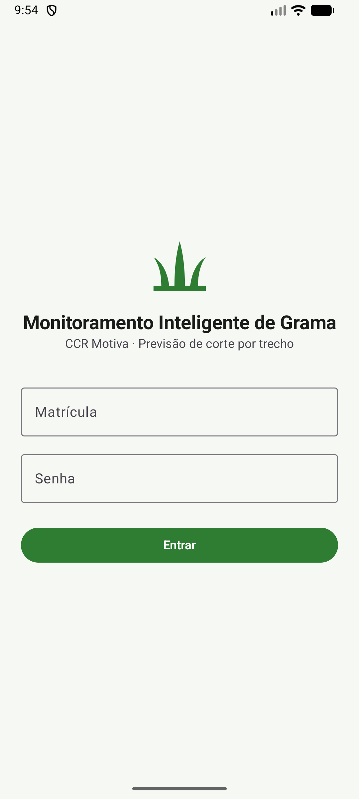
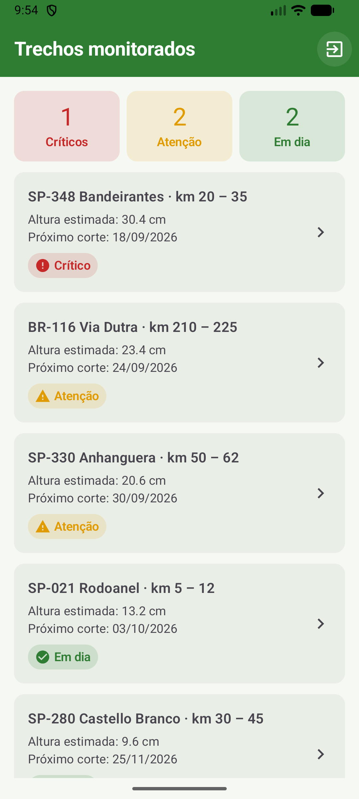
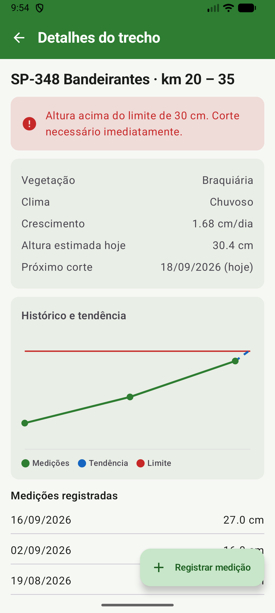
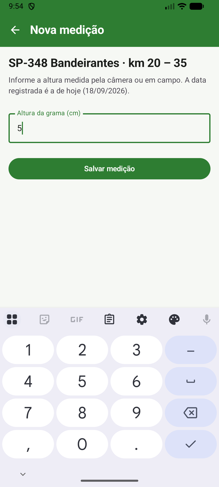
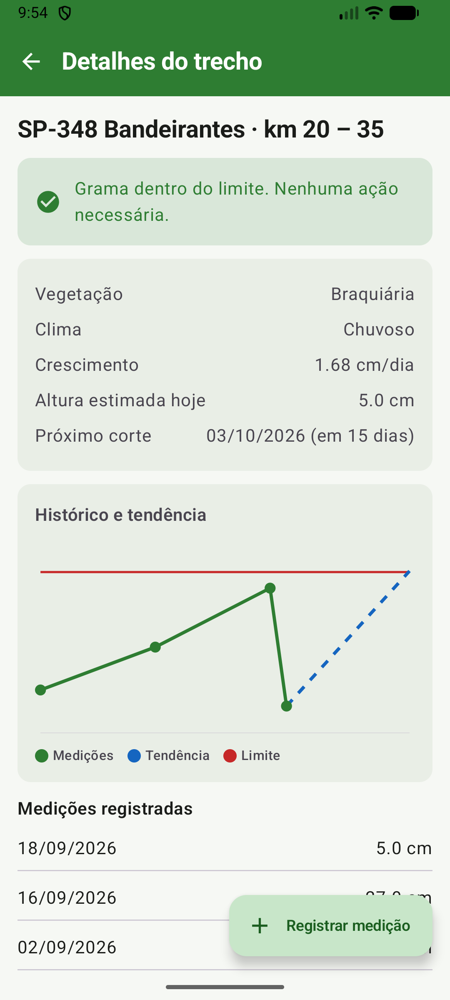

# Monitora Grama — MVP Android

MVP do **Monitoramento Inteligente de Grama** (CCR Motiva). Um carro com câmera de visão computacional mede a altura da grama nos trechos de rodovia a cada 2 semanas. O app mostra os trechos, prevê a data do próximo corte (limite de **30 cm**) e permite registrar novas medições.

Feito em **Kotlin + Jetpack Compose**, com arquitetura em camadas (`ui` / `domain` / `data` / `navigation`), MVVM e **persistência local** em SQLite (Room) e SharedPreferences.

## Fluxo do MVP

```
Login ──► Dashboard (trechos) ──► Detalhe do trecho ──► Nova medição
  ▲              │                        ▲                   │
  └── sair ──────┘                        └──── salvar ───────┘
```

| 1. Login | 2. Dashboard | 3. Detalhe | 4. Nova medição | 5. Após salvar |
|---|---|---|---|---|
|  |  |  |  |  |

Wireframe usado como especificação: [`docs/wireframe.svg`](docs/wireframe.svg)

## Arquitetura (app/src/main/)

```
AndroidManifest.xml                 Application + MainActivity (launcher)
java/br/com/monitoragrama/
├── MainActivity.kt                 Entrada: tema e rota inicial conforme a sessão salva
├── MonitoraGramaApp.kt             Application: cria o AppContainer e a carga inicial
├── di/AppContainer.kt              Injeção de dependências manual
├── navigation/AppNavHost.kt        Rotas e NavHost
├── domain/                         Regras de negócio (Kotlin puro, sem Android)
│   ├── model/                      Trecho, Medicao, PrevisaoCorte, PainelTrechos, RegrasCorte
│   ├── repository/                 Interfaces TrechoRepository e SessaoRepository
│   └── usecase/                    PreverCorte, ObservarTrechos, ObservarTrecho,
│                                   RegistrarMedicao, ValidarLogin, Entrar, Sair,
│                                   SessaoAtiva, DefinirFiltroCriticos
├── data/                           Acesso a dados
│   ├── local/                      Room (AppDatabase, TrechoDao, entidades, Conversores),
│   │                               TrechosIniciais e SessaoPreferences
│   └── repository/                 TrechoRepositoryImpl e SessaoRepositoryImpl
└── ui/                             Interface (Compose)
    ├── theme/                      Tokens: Color, Dimens, Type, Theme
    ├── components/                 AppTopBar, StatusBadge, AlertaStatus,
    │                               GraficoCrescimento, Estados (carregando/erro/vazio)
    ├── common/                     UiState e utilitários de ViewModel
    └── login/  dashboard/  detalhe/  medicao/   Screen + ViewModel de cada tela
res/
├── drawable/                       Ícones vetoriais extraídos do wireframe
├── mipmap-anydpi/                  Ícone adaptativo do app
└── values/                         strings.xml (+ plurals), colors.xml, themes.xml
```

**Regra de dependência:** `ui → domain ← data`. O `domain` não conhece Android nem a camada `data`; as telas só falam com ViewModels, que chamam casos de uso. Nenhum Composable calcula previsão, ordena, filtra ou acessa banco.

### Regra de previsão (domain/usecase/PreverCorteUseCase.kt)

- Taxa de crescimento = taxa da espécie (Braquiária 1,2 · Batatais 0,8 · Esmeralda 0,5 cm/dia) × fator do clima (Chuvoso 1,4 · Temperado 1,0 · Seco 0,6).
- Altura estimada hoje = última medição + taxa × dias desde a medição.
- **Crítico:** já passou de 30 cm · **Atenção:** passa de 30 cm antes da próxima vistoria (14 dias) · **Em dia:** caso contrário.

## Persistência local

Duas tecnologias, cada uma no seu papel:

**SQLite via Room** — registros do app (`data/local/`):

| Tabela | Conteúdo |
|---|---|
| `trechos` | id, rodovia, km inicial/final, vegetação, clima |
| `medicoes` | trecho, data e altura; chave composta (trecho + data) e FK em cascata |

- O DAO devolve `Flow`, então gravar uma medição atualiza dashboard e detalhe sozinho.
- A chave composta garante **uma medição por dia**: salvar de novo no mesmo dia substitui a anterior em vez de duplicar.
- `Conversores` traduz `LocalDate` para número do dia, que é o que o SQLite entende.
- Na primeira execução o app grava a carga inicial de 5 trechos (`TrechosIniciais`); nas seguintes só lê o que está no banco.

**SharedPreferences** — dados simples (`data/local/SessaoPreferences.kt`):

| Chave | Uso | Padrão |
|---|---|---|
| `matricula` | sessão do operador: o app reabre direto no painel | ausente (vai para o login) |
| `somente_criticos` | filtro do dashboard | `false` |

As medições registradas e a sessão continuam lá depois de fechar e reabrir o app.

## Gerenciamento de estados e tratamento de erros

`ui/common/UiState.kt` define os três estados que as telas assumem:

```kotlin
sealed interface UiState<out T> {
    data object Carregando : UiState<Nothing>
    data class Sucesso<T>(val dados: T) : UiState<T>
    data class Erro(val mensagem: Int) : UiState<Nothing>
}
```

- Cada ViewModel converte o `Flow` do repositório em `UiState` e fecha com `catch`: uma exceção do banco vira **estado de erro na tela**, nunca um crash.
- A tela de erro mostra mensagem amigável e **Tentar novamente**, que reinscreve no banco.
- A gravação atravessa `Result` (`runCatching` no repositório) e chega à UI como `ResultadoMedicao.FalhaAoSalvar`.
- Validações ficam no domínio: login (4+ caracteres) e altura entre 0,1 e 200 cm, com erro no próprio campo.
- Estado de negócio mora no ViewModel (sobrevive à rotação); estado só visual usa `rememberSaveable` nos Composables — mostrar/ocultar senha no login e expandir o histórico no detalhe.

## Boas práticas aplicadas

- Nenhum texto fixo no código: tudo em `strings.xml` (com `plurals`); cores e espaçamentos em tokens (`Color.kt`, `Dimens.kt`).
- Estado com `StateFlow` + `collectAsStateWithLifecycle` (respeita o ciclo de vida); ViewModels sobrevivem à rotação.
- Argumentos de navegação lidos via `SavedStateHandle`.
- Eventos de navegação consumidos uma única vez; cliques repetidos ignorados enquanto a tela sai (`estaAtiva()`).
- Acesso a dados sempre por interface, o que permite testar as regras com dublês, sem banco e sem emulador.
- Testes unitários em `app/src/test`: previsão de corte, validação de login, montagem do painel, registro de medição e mapeamento entidade ↔ domínio.

## Como executar

1. Abra a pasta no **Android Studio** e aguarde o Gradle sincronizar.
2. Selecione um emulador (API 26+) e clique em **Run ▶**.
3. Login: qualquer matrícula e senha com 4+ caracteres (ex.: `rm12345` / `senha123`).

Para voltar ao estado inicial (recriar a carga do banco e limpar a sessão), desinstale o app ou use **Limpar dados** nas configurações do Android.
